class: middle
background-size: contain

<!----- Make a pdf using:

decktape generic --key=ArrowRight --load-pause 1800 --slides '1-81' --size '1216x684' --url-load-timeout 80000 --page-load-timeout 40000  "week-06-bivariate-linear-regression/slides/week-06-bivariate-lm.html" week-06-bivariate-linear-regression/slides/week-06-bivariate-lm.pdf

----->

<br><br><br>

# .tuos_purple[EDC459: Week 7<br>SQL, Data Tidying & Assessment Preparation]

<br><br>

**Dr. Calum Webb**<br>
Sheffield Methods Institute, the University of Sheffield.<br>
[c.j.webb@sheffield.ac.uk](mailto:c.j.webb@sheffield.ac.uk)

```{r setup, include=FALSE}
options(htmltools.dir.version = FALSE)

# These packages are required for creating the slides
# Many will need to be installed from Github
library(icons)
library(tidyverse)
library(xaringan)
library(xaringanExtra)
library(xaringanthemer)

# Defaults for code
knitr::opts_chunk$set(
  fig.width=9, fig.height=3.5, fig.retina=3,
  out.width = "100%",
  cache = FALSE,
  echo = TRUE,
  message = FALSE, 
  warning = FALSE,
  fig.show = TRUE,
  hiline = TRUE
)

# set global theme for ggplot to make background #F8F8F8F8 (off white),
# but otherwise keep all ggplot themes default (better for teaching)
theme_set(
  theme(plot.background = element_rect(fill = "#F8F8F8", colour = "#F8F8F8"), 
        panel.background = element_rect(fill = "#F8F8F8", colour = "#F8F8F8"), 
        legend.background = element_rect(fill = "#F8F8F8", colour = "#F8F8F8")
        )
  )

theme_minimal <- function() 
  {
    ggplot2::theme_minimal() +
    theme(plot.background = element_rect(fill = "#F8F8F8", colour = "#F8F8F8"), 
        panel.background = element_rect(fill = "#F8F8F8", colour = "#F8F8F8"), 
        legend.background = element_rect(fill = "#F8F8F8", colour = "#F8F8F8")
        )
}

theme_void <- function() 
  {
    ggplot2::theme_void() +
    theme(plot.background = element_rect(fill = "#F8F8F8", colour = "#F8F8F8"), 
        panel.background = element_rect(fill = "#F8F8F8", colour = "#F8F8F8"), 
        legend.background = element_rect(fill = "#F8F8F8", colour = "#F8F8F8")
        )
  }

```

```{r xaringan-tile-view, echo=FALSE}
# Use tile overview by hitting the o key when presenting
xaringanExtra::use_tile_view()
```

```{r xaringan-logo, echo=FALSE}
# Add logo to top right
xaringanExtra::use_logo(
  image_url = "header/smi-logo-white.png",
  exclude_class = c("inverse", "hide_logo"), 
  width = "180px", position = css_position(top = "1em", right = "2em")
)
```

```{r xaringan-themer, include=FALSE, warning=FALSE}

# Set some global objects containing the colours
# of the university's branding
primary_color <- "#131E29"
secondary_color <- "#440099"
tuos_blue <- "#9ADBE8"
white = "#F8F8F8"
tuos_yellow <- "#FCF281"
tuos_purple <- "#440099"
tuos_red <- "#E7004C"
tuos_midnight <- "#131E29"

# The bulk of the styling is handled by xaringanthemer
style_duo_accent(
  primary_color = "#131E29",
  secondary_color = "#440099",
  colors = c(tuos_purple = "#440099", 
             grey = "#131E2960", 
             tuos_blue ="#9ADBE8",
             tuos_mint = "#00CE7C"),
  header_font_google = xaringanthemer::google_font("Source Serif Pro", "600", "600i"),
  text_font_google   = xaringanthemer::google_font("Source Sans Pro", "300", "300i", "600", "600i"),
  code_font_google   = xaringanthemer::google_font("Lucida Console"),
  header_h1_font_size = "2rem",
  header_h2_font_size = "1.5rem", 
  header_h3_font_size = "1.25rem", 
  text_font_size = "0.9rem",
  code_font_size = "0.65rem", 
  code_inline_background_color = "#F8F8F8", 
  inverse_text_color = "#9ADBE8", 
  background_color = "#F8F8F8", 
  text_color = "#131E29", 
  link_color = "#005A8F", 
  inverse_link_color = "#F8F8F8",
  text_slide_number_color = "#44009970",
  table_row_even_background_color = "transparent", 
  table_border_color = "#44009970",
  text_bold_font_weight = 600
)

```


```{r xaringan-panelset, echo=FALSE}
# Allow for adding panelsets (see example on slide 2)
xaringanExtra::use_panelset(in_xaringan = TRUE)

style_panelset_tabs(
  background = "#F8F8F8",
  active_background = "#F8F8F8",
  hover_background = "#F8F8F8"
)


```

```{r xaringanExtra, echo = FALSE}
# Adds white progress bar to top
xaringanExtra::use_progress_bar(color = "#F8F8F8", location = "top")
```

```{r xaringan-extra-styles, echo = FALSE}
# Allow for code to be highlighted on hover
xaringanExtra::use_extra_styles(
  hover_code_line = TRUE,         #<<
  mute_unhighlighted_code = TRUE  #<<
)
```

```{r share-again, echo=FALSE}
# Add sharing links and other embedding tools
xaringanExtra::use_share_again()
```

```{r xaringanExtra-search, echo=FALSE}
# Add magnifying glass search function to bottom left for quick
# searching of slides
xaringanExtra::use_search(show_icon = TRUE, auto_search = FALSE)
```

---
class: middle

.pull-left[


]
.pull-right[

<br><br><br><br><br><br>

# Sign In

]

---

class: middle

## Learning Objectives

.panelset[

.panel[.panel-name[What will I learn?]

By the end of this week you will:

* Reinforce your understanding of good data and project management for reproducible data analysis by having a tested and working R project directory set up for your assessment. 

* Gained experience connecting securely to and querying a real relational database hosted on an external server.

* Have a conceptual and practical understanding of essential data tidying skills, having applied selects, filters, mutates, pivots, and joins in both `R` and `SQL`.

* Have put these skills together in order to build a reproducible analytical pipeline that a) connects to an external database, b) queries and joins relational data, c) tidies data and reformats it from long format to wide format, d) visualises and analyses the data in line with the tasks in Part A of the assessment, e) produces a shareable PDF report using RMarkdown.

]

.panel[.panel-name[How does this week fit into my course?]

* The content from this week is designed specifically to support you with getting started on your assessment, breaking down the tasks in the assessment brief, and building your employability.

* Some knowledge of SQL is a skill that is essential or desirable across a large range of research and data science-related jobs, especially outside of academia.

* Picking up some SQL is a way to demonstrate that the programming knowledge you have learned in R is transferable to other programming languages — you are in no way limited to R in your future research and career!


]


]


???


---

class: middle, inverse

## Today's session is designed to be more interactive and hands-on than our other sessions. We'll mostly be working together through a series of lecture notes; these are available on Blackboard.

---

class: middle, inverse

.pull-left[

<br><br>

# Data tidying requires the use of multiple tools

* The idea of today is to introduce you to all the tools that will allow you to tidy any untidy dataset.
* You won't be able to use all of them perfectly right from the start.
* But if you invest time into learning to use them, you can become very proficient in data tidying.


]

.pull-right[

.center[
```{r, echo = FALSE, out.width = "80%"}


```
]

]

---

class: middle, inverse

.pull-left[

<br><br>

# Why spend time learning how to tidy data?

* Tidying data and preparing it for analysis or visualisation is often the most time consuming part of any quantitative research project.
* Tidying data is not often reproducable *unless it has been tidied programatically*.

]

.pull-right[

.center[
```{r, echo = FALSE, out.width = "80%"}


```
]

]

---

class: middle, inverse

.pull-left[

<br><br>

# Why SQL?

* We could just go through how to tidy everything in R — some of the tools we're talking about today we've already been using.
* But, Structured Query Language (SQL) is a skill that a large number of employers expect for quantitative research, data analyst, and data science roles.
* It is not that difficult to learn, but it is hard to find straightforward and realistic ways to practice it outside of learning 'on-the-job' unless you are also quite tech-minded and can set up your own local database or server.

]

.pull-right[

.center[
```{r, echo = FALSE, out.width = "80%"}


```
]

]

---


<br><br><br><br>

.pull-left[

```{r, echo = FALSE, out.width="100%", fig.alt="Job advert reads Senior Research Data Analyst. The role will be responsible for all aspects of data collection and providing data reporting and analytics support to the directorate. The post-holder will play a key role in the collection, management and reporting of high-volume research data, serving a range of different purposes. "}

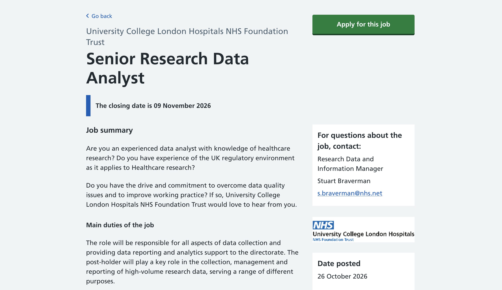

```

]

.pull-right[

```{r, echo = FALSE, out.width="100%", fig.alt="Essential criteria include: Experience, Skills & Abilities Essential. Experience of relational databases. In depth specialist knowledge of information analysis and the use of information across the research pathway acquired through degree or equivalent experience. Data management and reporting experience. Developing the technical skills of others"}

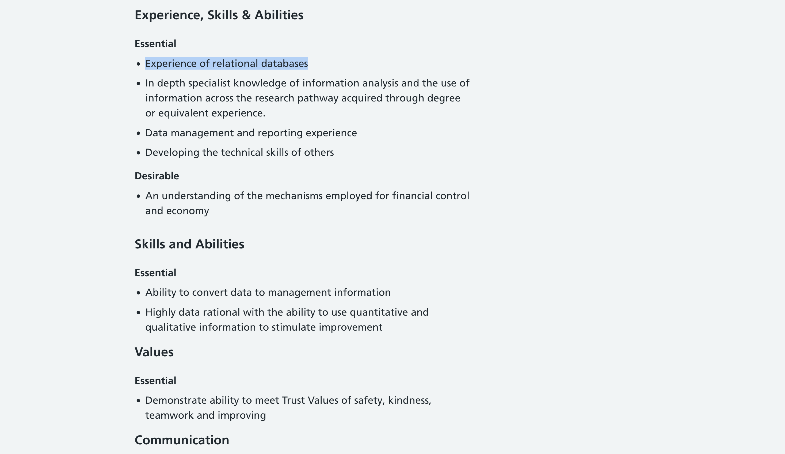

```

]

---


<br><br><br><br>

.pull-left[

```{r, echo = FALSE, out.width="100%", fig.alt="Senior Statistical Data Analyst"}

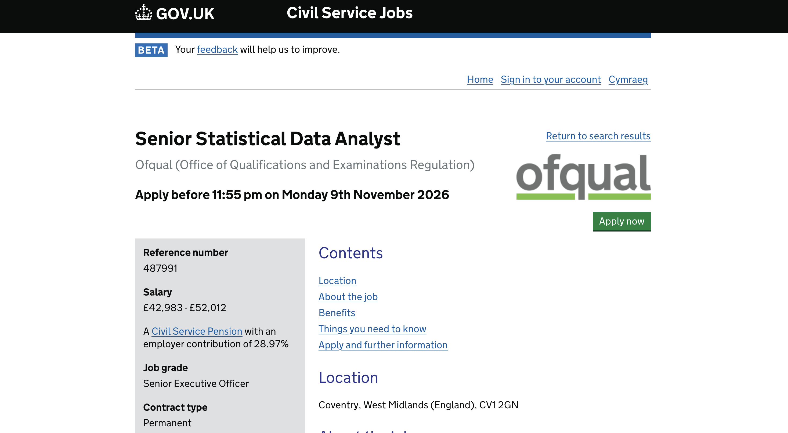

```

]

.pull-right[

<br><br>

```{r, echo = FALSE, out.width="100%", fig.alt="Should a large number of applications be received, an initial sift will be undertaken using the work history and personal statement against the lead essential criteria, which is fluency in the R statistical programming language, applying this to analyst and interpret large data sets. Some experience of other similar languages also desirable (for example, Python, SQL, SAS)."}

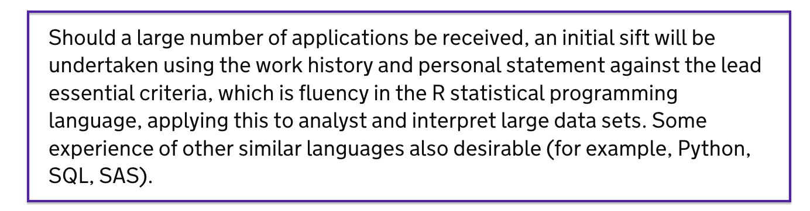

```

]

---


<br><br><br><br><br><br>

.pull-left[


```{r, echo = FALSE, out.width="100%", fig.alt="Data Analyst (SEND) Camden Council"}

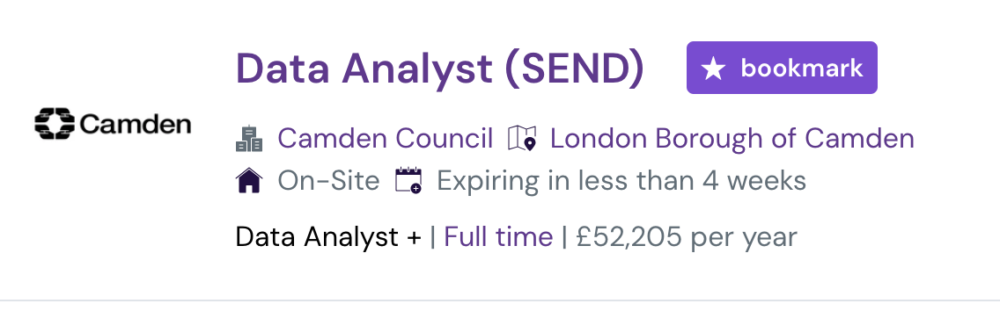

```

]

.pull-right[


```{r, echo = FALSE, out.width="100%", fig.alt="IT and mathematics: You will apply your knowledge and experience of IT and mathematical skills, including tools and techniques. You can adopt those most appropriate for the environment and always work in a manner that is sensitive to information security. You will use your experience of using a variety of tools such as MS Excel, Qlik, PowerBI, SQL, R, Python, QGIS."}

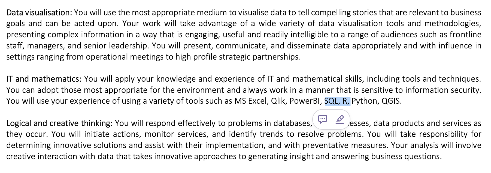

```

]

---


<br><br>

.pull-left[

<br><br>

```{r, echo = FALSE, out.width="100%", fig.alt="Lead Business Intelligence Analyst"}

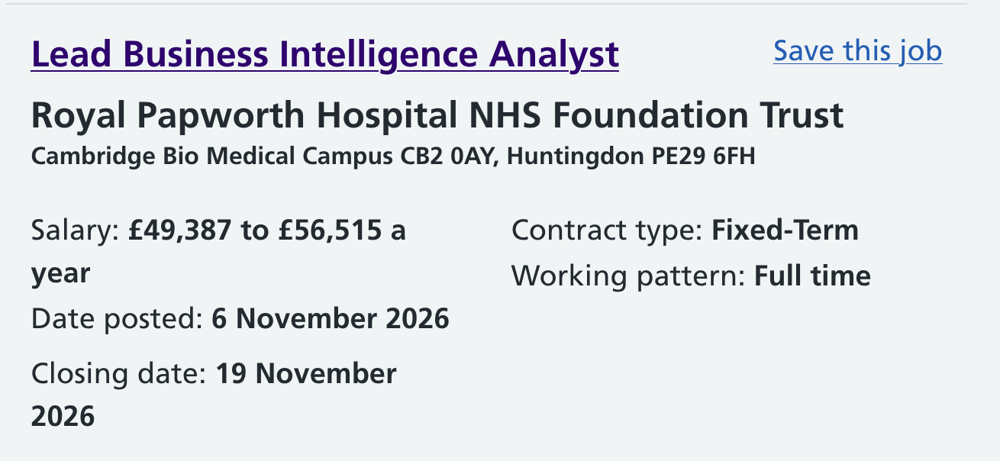

```

]

.pull-right[


```{r, echo = FALSE, out.width="100%", fig.alt="Ability to write detailed analytic queries in SQL, investigate and resolve complex queries, issues and problems."}

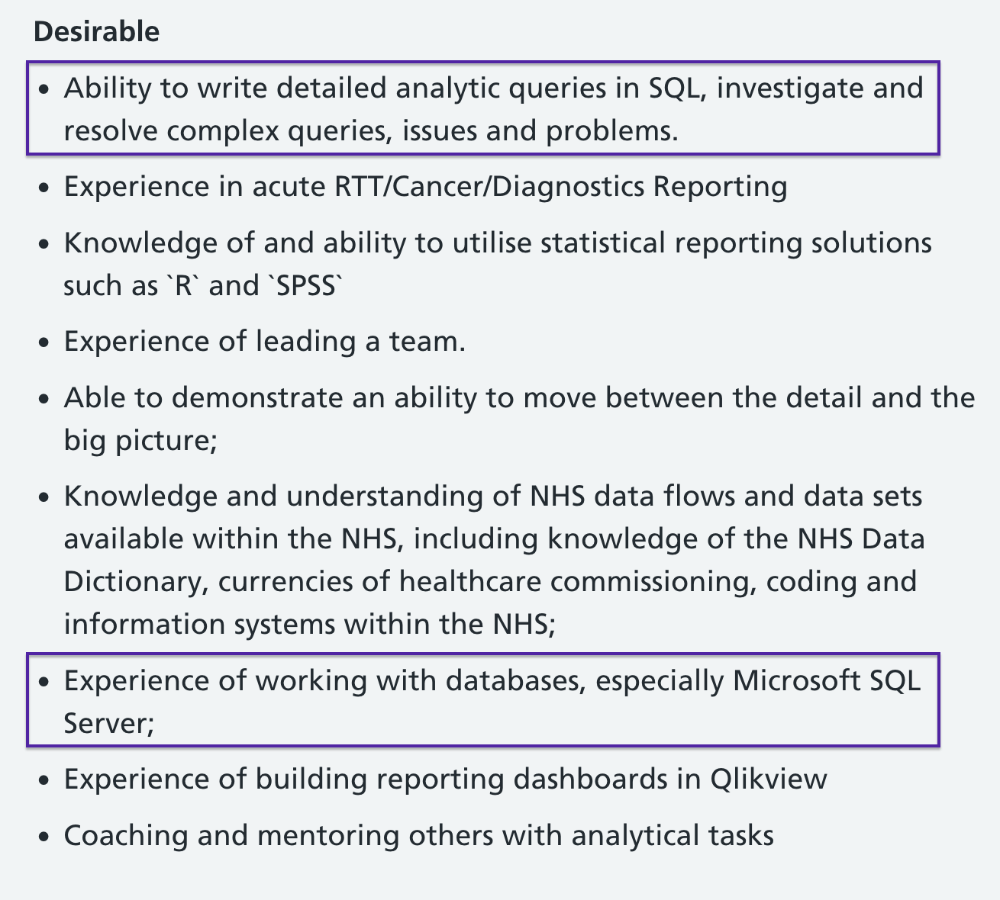

```

]

---


<br><br><br><br>

.pull-left[

<br>

```{r, echo = FALSE, out.width="100%", fig.alt="NHS Senior Research Data Analyst"}

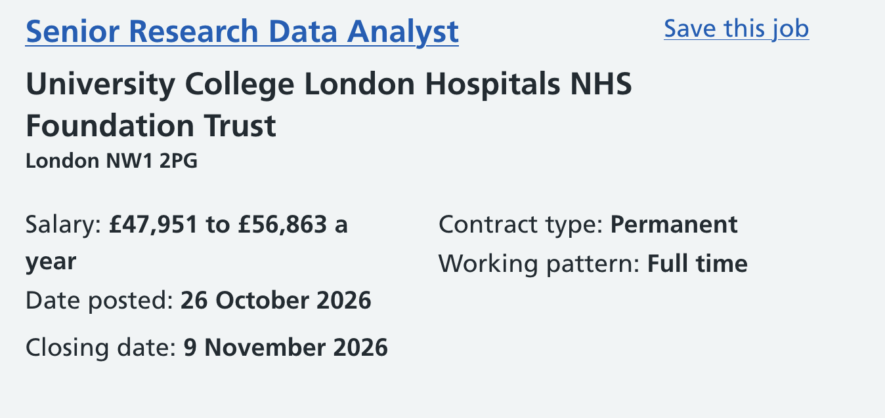

```

]

.pull-right[


```{r, echo = FALSE, out.width="100%", fig.alt="Essential criteria: Ability to interrogate databases."}

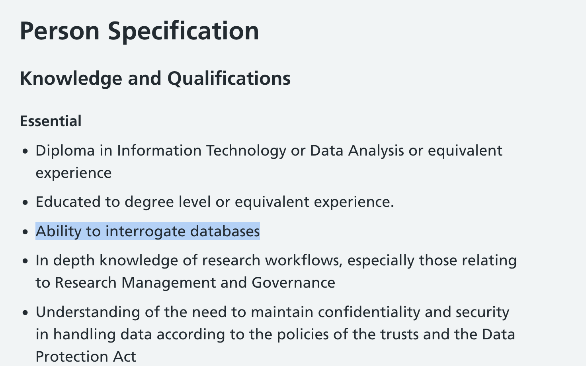

```

]

---

<br><br><br>

.pull-left[

<br>

```{r, echo = FALSE, out.width="100%", fig.alt="Archdioceses of Southward Data Analyst Job listing"}


```

]

.pull-right[


```{r, echo = FALSE, out.width="100%", fig.alt="Desirable criteria: Certification in data tools such as Power BI or SQL."}

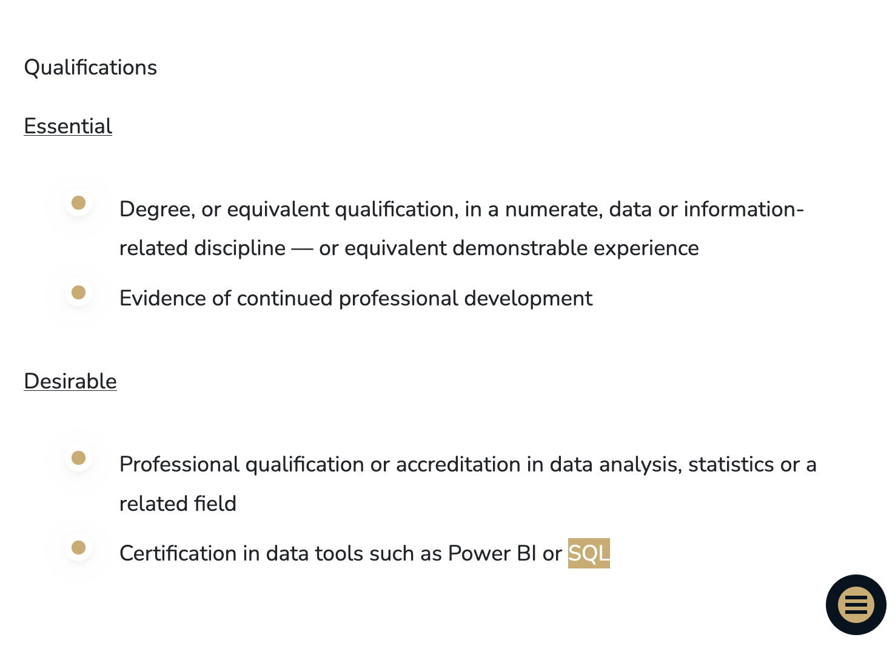

```

]

---

<br><br><br>

.pull-left[


```{r, echo = FALSE, out.width="100%", fig.alt="Cancer Research UK Job listing Digital Analyst (FTC)"}

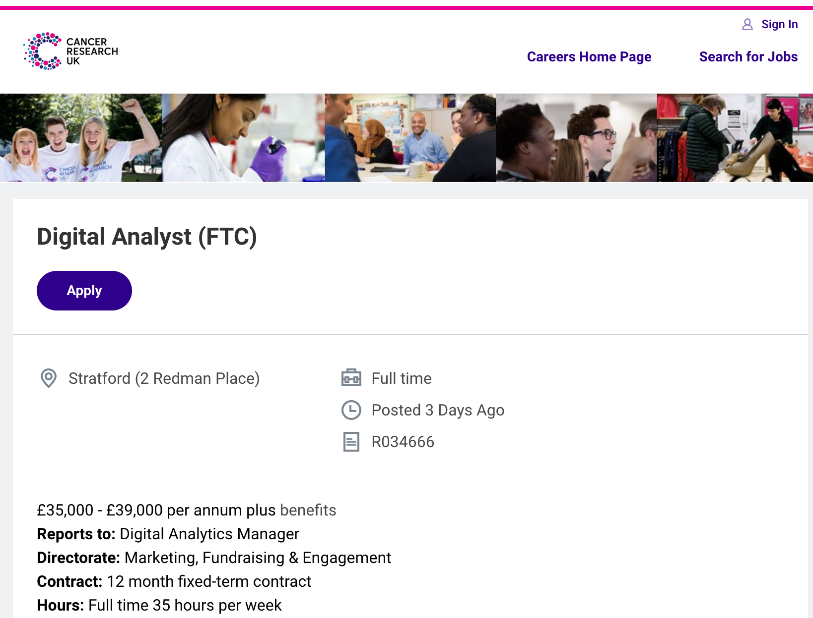

```

]

.pull-right[


```{r, echo = FALSE, out.width="100%", fig.alt="What are we looking for? Strong analytical skills, with experience working with large datasets and tools such as SQL, Python or R."}

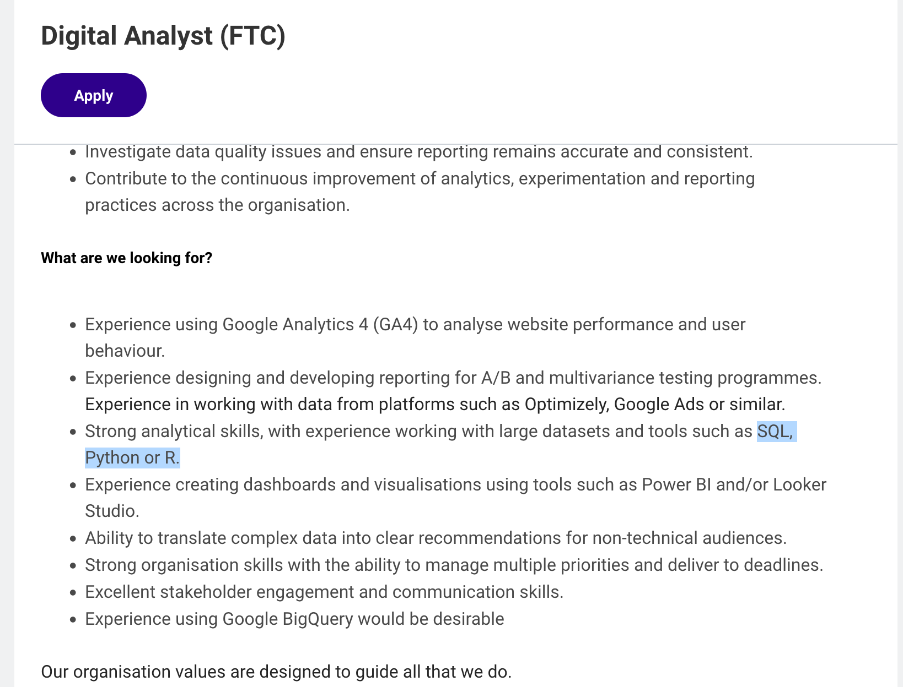

```

]


---

class: middle, inverse

## Introduction: What is tidy data?


---

background-color: white

.center[
```{r, echo = FALSE, out.width = "80%"}

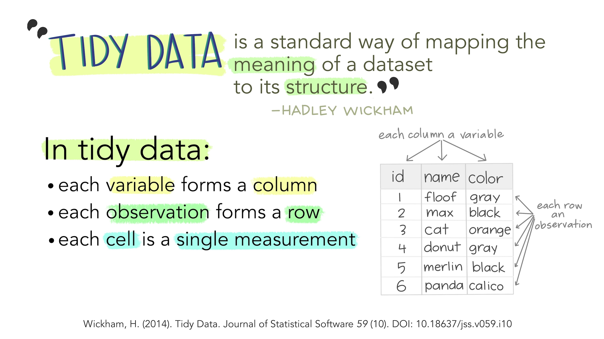

```
]

.footnote[
.right[Illustrations from the [Openscapes](https://www.openscapes.org/) blog [Tidy Data for reproducibility, efficiency, and collaboration](https://www.openscapes.org/blog/2020/10/12/tidy-data/) by Julia Lowndes and Allison Horst] 
]


---

background-color: white

.center[
```{r, echo = FALSE, out.width = "80%"}

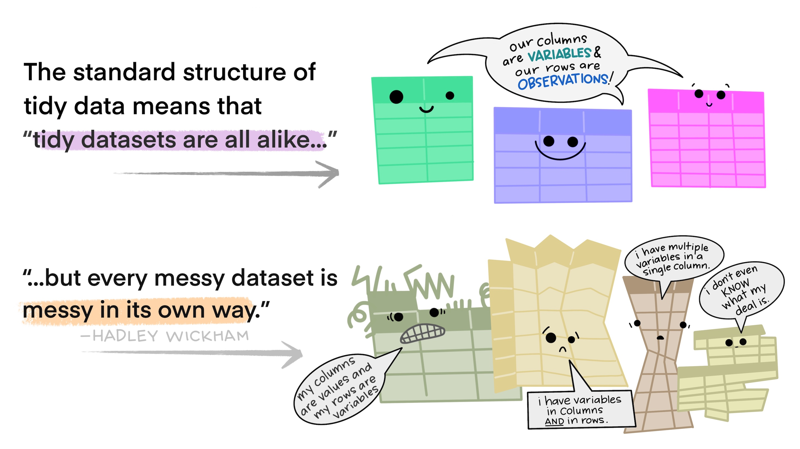

```
]

.footnote[
.right[Illustrations from the [Openscapes](https://www.openscapes.org/) blog [Tidy Data for reproducibility, efficiency, and collaboration](https://www.openscapes.org/blog/2020/10/12/tidy-data/) by Julia Lowndes and Allison Horst] 
]

---

background-color: white

.center[
```{r, echo = FALSE, out.width = "80%"}

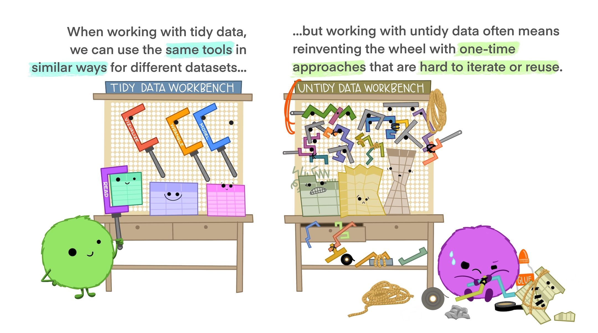

```
]

.footnote[
.right[Illustrations from the [Openscapes](https://www.openscapes.org/) blog [Tidy Data for reproducibility, efficiency, and collaboration](https://www.openscapes.org/blog/2020/10/12/tidy-data/) by Julia Lowndes and Allison Horst] 
]

---

background-color: white

.center[
```{r, echo = FALSE, out.width = "80%"}

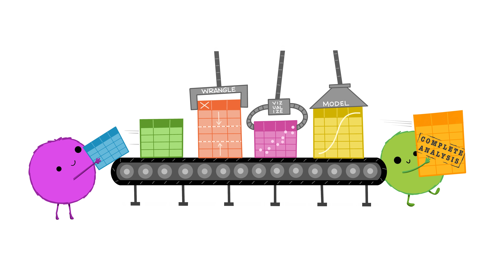

```
]

.footnote[
.right[Illustrations from the [Openscapes](https://www.openscapes.org/) blog [Tidy Data for reproducibility, efficiency, and collaboration](https://www.openscapes.org/blog/2020/10/12/tidy-data/) by Julia Lowndes and Allison Horst] 
]


---

class: inverse, middle

## 1. Reading data from different data sources and select/rename columns.

* Reading data from Stata, SPSS, and Excel files
* Filtering variables using select()
* Generalised select()

---

background-color: white

<br> 

.center[
```{r, echo = FALSE, out.width = "80%"}

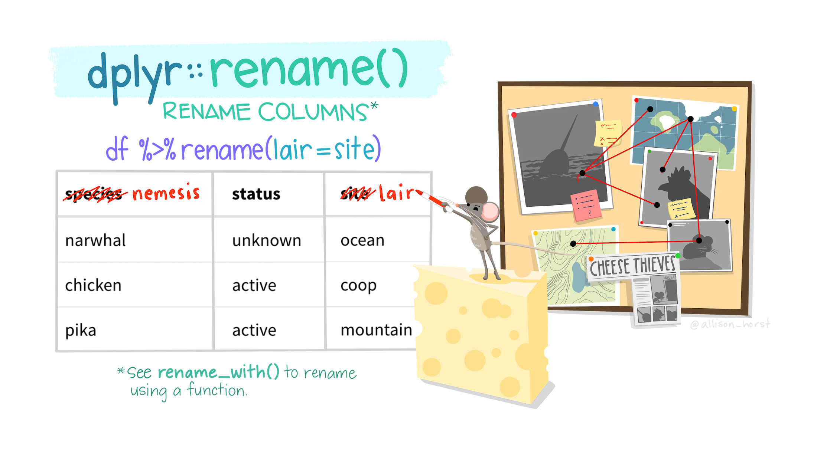

```
]


.footnote[
.right[[Artwork by @allison_horst](https://twitter.com/allison_horst)]

]

---

background-color: white

<br> 

.center[
```{r, echo = FALSE, out.width = "80%"}

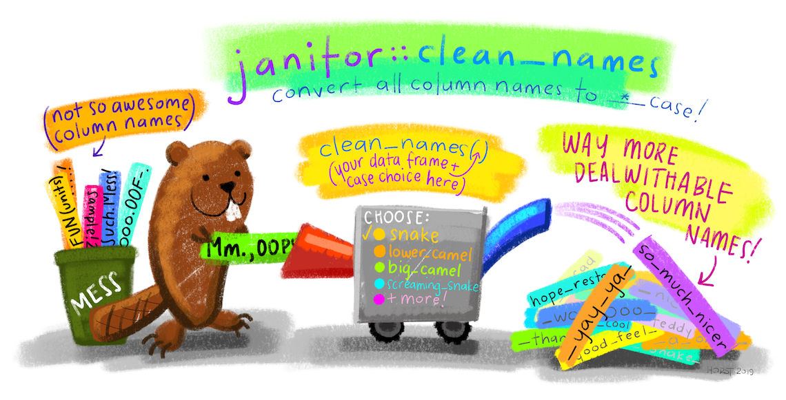

```
]


.footnote[
.right[[Artwork by @allison_horst](https://twitter.com/allison_horst)]

]


---

class: inverse, middle

## 2. Creating new variables using mutate()

* Creating new variables that are transformations of existing variables
* Recoding categorical variables using case_when()
* Extracting numbers with parse_number()
* Performing repeated/generalised transformations


---

background-color: white

<br> 

.center[
```{r, echo = FALSE, out.width = "60%"}

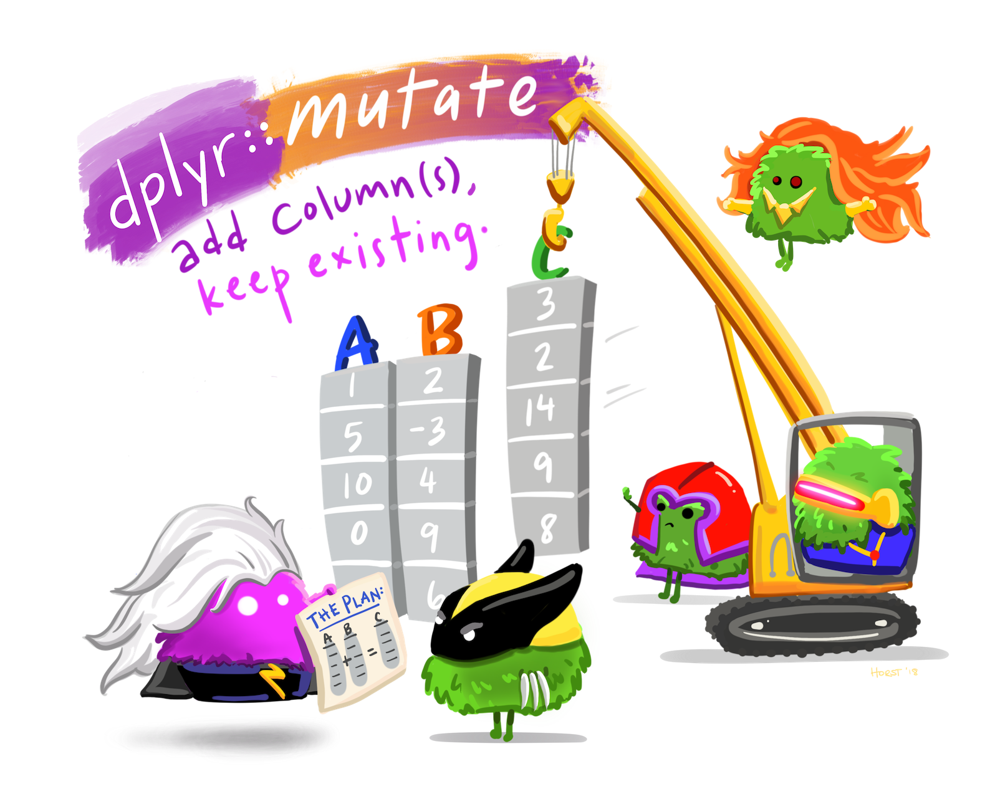

```
]


.footnote[
.right[[Artwork by @allison_horst](https://twitter.com/allison_horst)]

]

---

background-color: white

<br> 

.center[
```{r, echo = FALSE, out.width = "80%"}

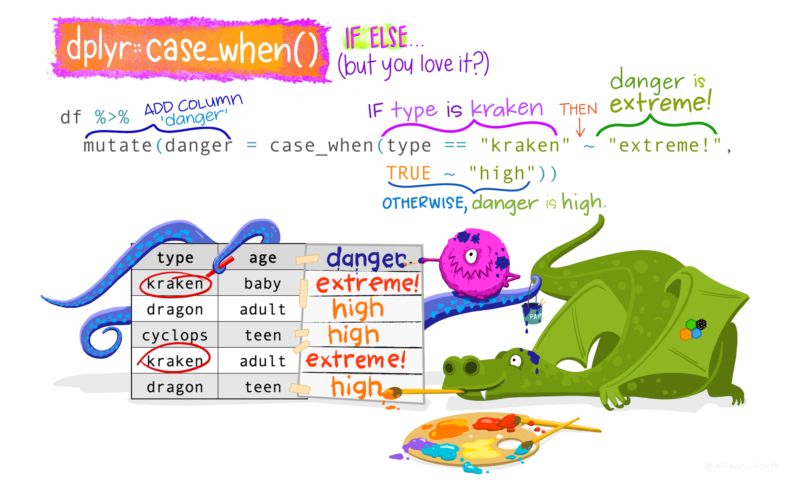

```
]


.footnote[
.right[[Artwork by @allison_horst](https://twitter.com/allison_horst)]

]

---

background-color: white

<br> 

.center[
```{r, echo = FALSE, out.width = "50%"}

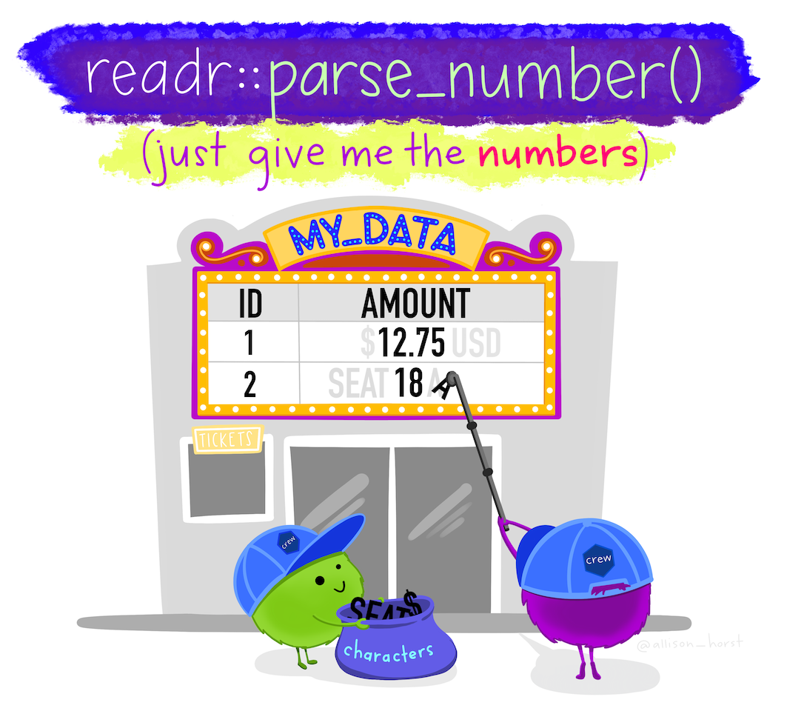

```
]


.footnote[
.right[[Artwork by @allison_horst](https://twitter.com/allison_horst)]

]

---

class: inverse, middle

## 3. Aggregating data to higher levels with group_by()

* Creating new, aggregated datasets using group_by() and summarise()
* Adding group-level variables for multilevel models using group_by() and mutate()


---

background-color: white

.center[

<video width="100%" height="500" controls autoplay="true" loop="true">
<source src="images/3-grp-summarize-01.mp4" type="video/mp4">
</video>


]


.footnote[
.right[[Animation by Andrew Heiss](https://www.andrewheiss.com/blog/2024/04/04/group_by-summarize-ungroup-animations/)]

]


---

class: inverse, middle

## 4. Pivoting data between wide and long formats

* Converting wide datasets suitable for Latent Growth Structural Equation Modelling to long datasets suitable for multilevel modelling.
* ... and the reverse.


---

background-color: white

.center[
```{r, echo = FALSE, out.width = "40%"}

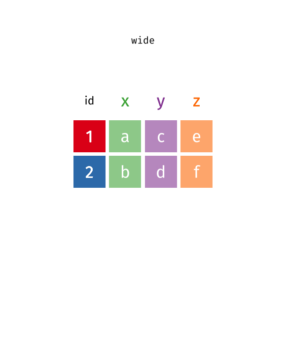

```
]


.footnote[
.right[[Animation by Garrick Aden-Buie](https://www.garrickadenbuie.com/project/tidyexplain/)]

]

---

background-color: white

<br>

.center[
```{r, echo = FALSE, out.width = "60%"}

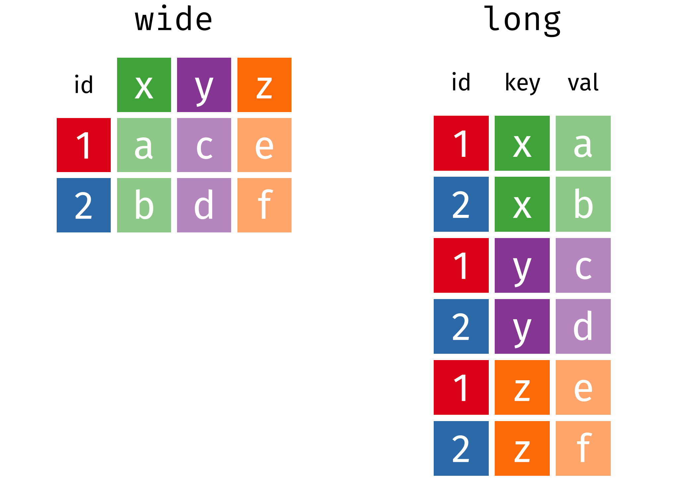

```
]


.footnote[
.right[[Animation by Garrick Aden-Buie](https://www.garrickadenbuie.com/project/tidyexplain/)]

]


---

class: inverse, middle

## 5. Working with strings and a little bit of regex

* How to remove certain characters or strings from character type variables (especially footnotes).
* Extracting subsets of characters from longer strings.
* Splitting variables into multiple columns based on a character within a string.

---

background-color: white

<br> 

.center[
```{r, echo = FALSE, out.width = "60%"}

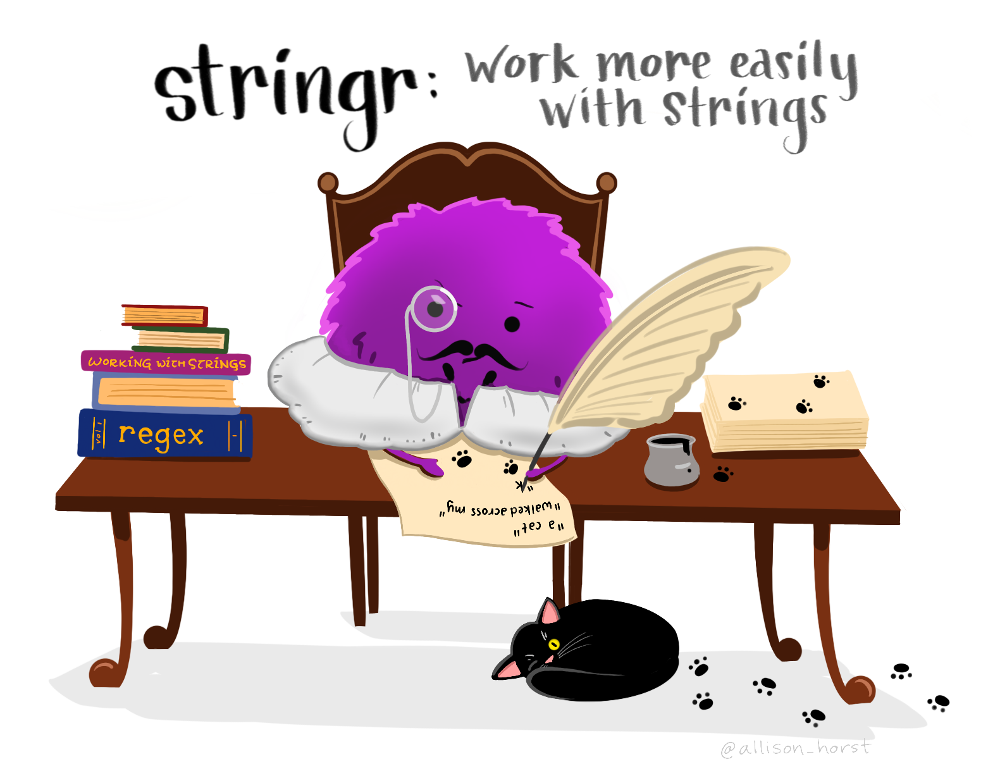

```
]


.footnote[
.right[[Artwork by @allison_horst](https://twitter.com/allison_horst)]

]

---

background-color: white

<br> 

.center[
```{r, echo = FALSE, out.width = "80%"}

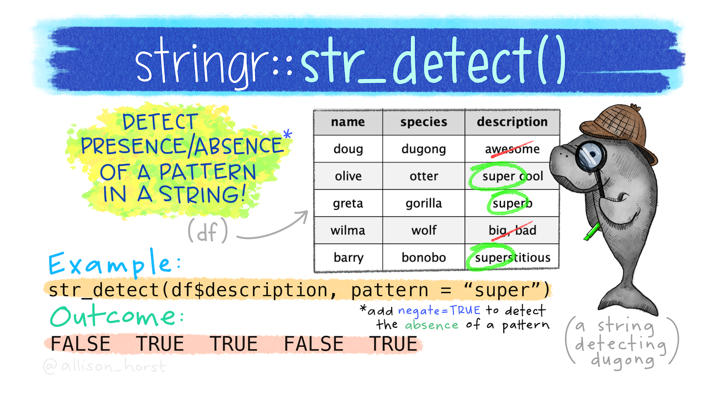

```
]


.footnote[
.right[[Artwork by @allison_horst](https://twitter.com/allison_horst)]

]


---

class: inverse, middle

## 6. Joining relational datasets

* Joining datasets based on a shared key
* Joining datasets together based on a combination of variables that form a key
* Joining higher level data to lower level data
* Checking for missing observations with anti_join()

Key: A value, usually a string, that uniquely identifies each observation across multiple related (relational) datasets

---

background-color: white

<br>

.center[
```{r, echo = FALSE, out.width = "60%"}

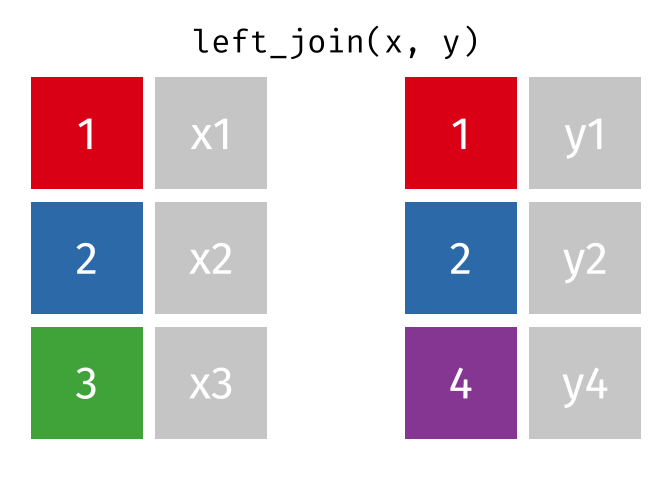

```
]


.footnote[
.right[[Animation by Garrick Aden-Buie](https://www.garrickadenbuie.com/project/tidyexplain/)]

]

---

background-color: white

<br>

.center[
```{r, echo = FALSE, out.width = "60%"}

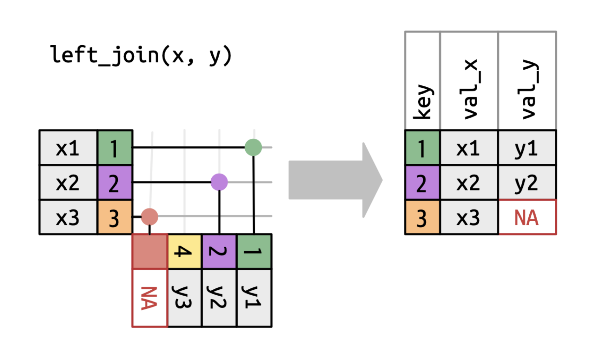

```
]


.footnote[
.right[[Diagram from R for Data Science 2e](https://r4ds.hadley.nz)]

]

---

class: inverse, middle

## 7. Working with dates

* How to fix how R interprets dates when they aren't in YYYY-MM-DD format.

---

background-color: white

<br> 

.center[
```{r, echo = FALSE, out.width = "70%"}

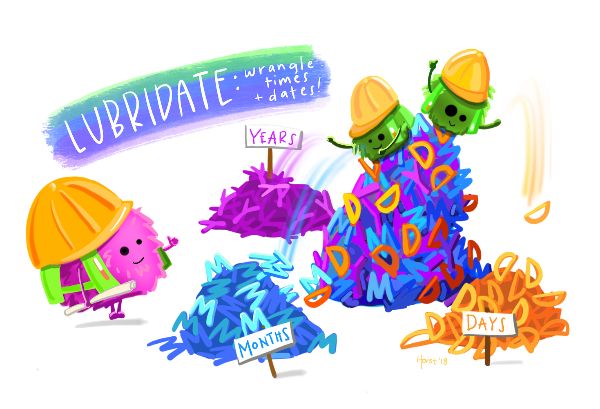

```
]


.footnote[
.right[[Artwork by @allison_horst](https://twitter.com/allison_horst)]

]

---

class: inverse, middle

## 8. Filtering rows of observations

* How to filter data based on values in character/factor type variables
* How to filter data based on numeric type variables
* How to filter data based on dates

---

background-color: white

<br> 

.center[
```{r, echo = FALSE, out.width = "80%"}

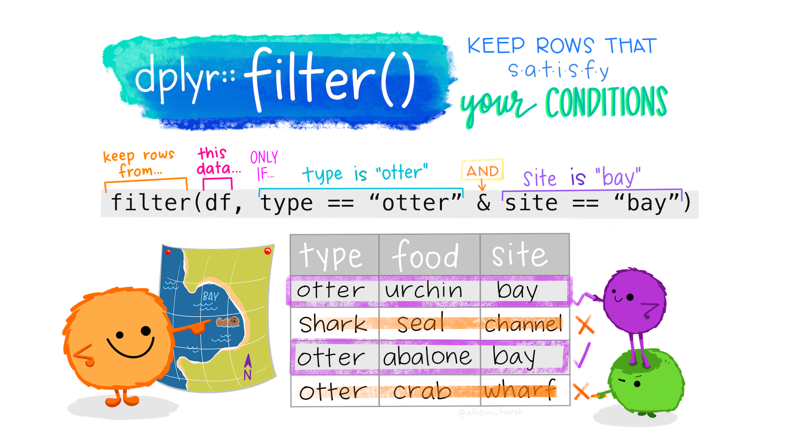

```
]


.footnote[
.right[[Artwork by @allison_horst](https://twitter.com/allison_horst)]

]

---

class: middle, inverse

.pull-left[


# That's a preview of some of the tools we'll be using today.

* Don't expect to be perfect at this just from a few attempts! I have the benefit of over ten years experience tidying datasets.

* If you keep practicing tidying untidy datasets, using these tools will eventually become effortless. Untidy data becomes a puzzle to solve. But when you're just starting out, the puzzles will be frustrating.


]

.pull-right[

.center[
```{r, echo = FALSE, out.width = "80%"}


```
]

]

---

.pull-left[

<br><br><br><br><br><br>

# Today's practical session

I am going to be working through the process of setting up our R project for our assessment, testing our RMarkdown files knit and that you know how to complete the coversheet and MySkills evidence, and then showing you how to use data tidying and reading tools in R and SQL. We'll then do a "fake" Part A assessment together using the data we tidied.

]

.pull-right[

<br><br>

```{r, echo = FALSE, out.width = "80%"}


```


]
